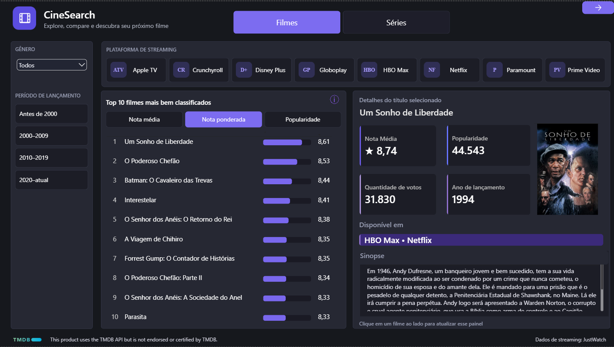
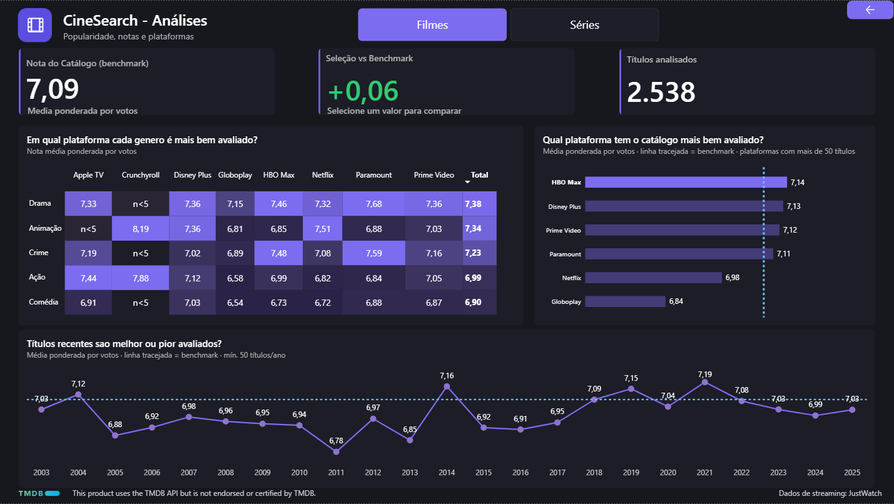

# 🎬 CineSearch

Dashboard em Power BI para explorar **filmes e séries**: quais são os mais bem avaliados, quais plataformas de streaming têm o melhor catálogo e como as notas mudam com o tempo.

Os dados vêm da API do **TMDB** (notas, votos, popularidade) e do **JustWatch** (onde cada título está disponível para assistir).

## 📸 Prévia

### Visão Geral



### Análises



## ❓ Perguntas que o dashboard responde

**Visão Geral**
- Quais são os 10 filmes mais bem avaliados?
- Em qual plataforma de streaming cada filme está disponível?
- Como muda o ranking por gênero e por período de lançamento?

**Análises**
- Em qual plataforma cada gênero é mais bem avaliado?
- Qual plataforma tem o catálogo mais bem avaliado?
- Títulos recentes são melhor ou pior avaliados que os antigos?

## 🧠 Como as notas funcionam

- **Nota média:** a nota que o TMDB mostra para o título.
- **Nota ponderada:** dá mais peso a títulos com muitos votos. Assim, um filme com poucos votos e nota alta não passa na frente de um clássico com milhares de avaliações.
- **Popularidade:** o índice de popularidade do TMDB.
- **Mínimo de votos:** só entram no ranking títulos com pelo menos **1.000 votos**, para evitar notas infladas.
- **Benchmark:** a média ponderada de todo o catálogo, usada como linha de comparação nos gráficos.

## 🔄 Como o projeto foi feito

1. **Coleta:** scripts em Python buscam os dados na API do TMDB e as plataformas de streaming do JustWatch.
2. **Tratamento:** os dados são limpos e organizados (Python e SQL).
3. **Dashboard:** o resultado é carregado no Power BI, onde estão as medidas e os gráficos.

## 📁 Estrutura do repositório

```
cinesearch-dashboard/
├── dashboard/   # arquivo do Power BI (.pbix)
├── docs/        # prints e documentação
├── src/         # scripts de coleta e tratamento
├── .gitignore
└── README.md
```

## 🛠️ Ferramentas usadas

- Python
- SQL
- Power BI (DAX)
- API do TMDB
- Dados de streaming do JustWatch

## ▶️ Como rodar o código de coleta

1. Clone o repositório:
   ```bash
   git clone https://github.com/gustavogomes-data/cinesearch-dashboard.git
   cd cinesearch-dashboard
   ```
2. Crie e ative um ambiente virtual:
   ```bash
   python -m venv .venv
   .venv\Scripts\activate
   ```
3. Instale as bibliotecas (ajuste conforme o seu código):
   ```bash
   pip install requests python-dotenv
   ```
4. Crie uma conta no [TMDB](https://www.themoviedb.org/) e gere sua chave de API.
5. Crie um arquivo `.env` na raiz do projeto com a sua chave:
   ```
   TMDB_API_KEY=sua_chave_aqui
   ```
6. Rode os scripts da pasta `src`.


## ⚠️ Limitações

- Este projeto compara as notas do TMDB entre os títulos coletados. Não é um ranking de qualidade geral do catálogo de cada plataforma.
- Os dados são uma foto do momento da coleta e mudam com o tempo.
- Títulos recém-lançados podem ter notas infladas nas primeiras semanas.
- Algumas plataformas têm poucos títulos, então certas células do gráfico aparecem como `n<5` (poucos dados para calcular a média).
- A disponibilidade nas plataformas vale para o Brasil e pode mudar.

## 📜 Créditos

- Este produto usa a API do TMDB, mas não é endossado nem certificado pelo TMDB.
- Dados de streaming: JustWatch.

## 👤 Autor

**Gustavo Gomes**
Linkedin: [gustavogomes](https://www.linkedin.com/in/gustavo-gomes-22a7aa305/)
